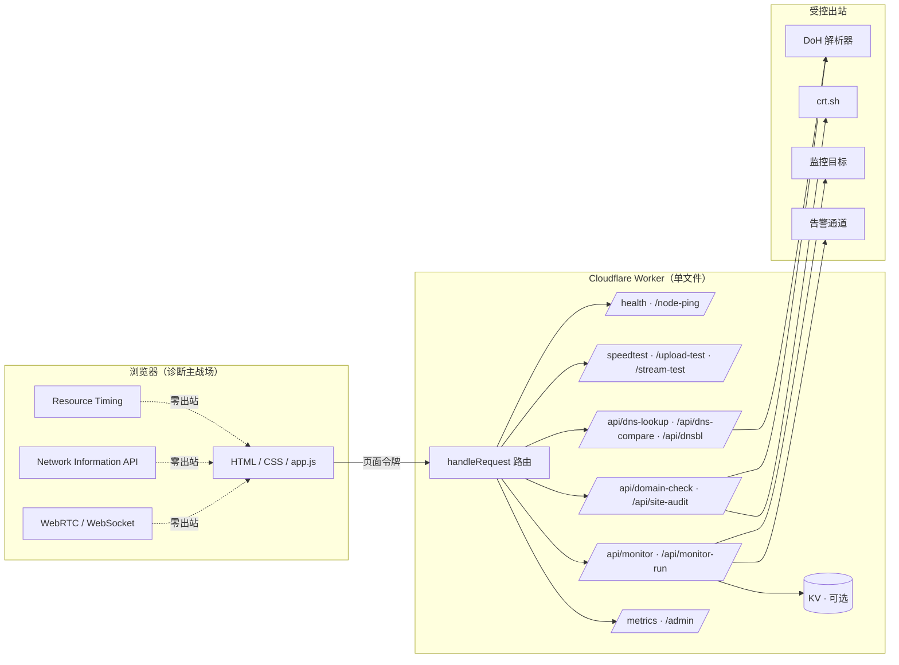

# NetSight Pro

> 把网络，看透。一个文件、一个 Worker，装下整条网络链路。

<p align="center">
  
</p>

<p align="center">
  <a href="#快速开始"></a>
  <a href="#部署"></a>
  <a href="#测试与-ci"></a>
  <a href="#多语言"></a>
  <a href="#运行时依赖"></a>
  <a href="#许可证"></a>
</p>

**NetSight Pro** 是一个运行在 Cloudflare Workers 上的边缘网络诊断工具箱。浏览器侧完成大部分测量，Worker 只在你显式触发时做少量出站（DoH、证书日志、站点监控、告警 webhook），默认情况下**零第三方埋点、零外部 CDN 依赖、零构建**。

它既是一份可以直接部署的**单文件 Worker**，也是一套可维护的模块化源码：`project/` 负责源码、构建、测试与 CI，`dist/_workers.js` 负责分发。

> English abstract: NetSight Pro is a single-file Cloudflare Worker for edge network diagnostics — 26 tools, 6 languages, live RTT monitoring, bandwidth tests, DNS/DoH comparison, domain security audits, uptime monitoring and alerting. Browser-first by default, with zero third-party analytics and zero runtime dependencies.

---

## 目录

- [项目简介](#项目简介)
- [功能速览](#功能速览)
- [工具目录](#工具目录)
- [界面与截图](#界面与截图)
- [架构与数据流](#架构与数据流)
- [快速开始](#快速开始)
- [部署](#部署)
- [配置参考](#配置参考)
- [API 参考](#api-参考)
- [站点监控与告警](#站点监控与告警)
- [安全模型](#安全模型)
- [可观测性](#可观测性)
- [多语言、主题与 PWA](#多语言主题与-pwa)
- [性能、成本与额度](#性能成本与额度)
- [测试与 CI](#测试与-ci)
- [项目结构](#项目结构)
- [静态展示页](#静态展示页)
- [常见问题](#常见问题)
- [路线图与待办](#路线图与待办)
- [更新日志](#更新日志)
- [贡献指南](#贡献指南)
- [许可证与致谢](#许可证与致谢)

---

## 项目简介

大多数「在线测速 / ping」网站把测量放在服务端，你只能看到一个结果；NetSight Pro 的思路相反：

1. **能由浏览器完成的，交给浏览器**：RTT、抖动、丢包、吞吐、WebRTC 泄漏、Resource Timing、`navigator.connection` 都在本地计算；
2. **必须由边缘完成的，收敛到少量受控端点**：健康检查、流式大响应、DoH 查询、证书日志、监控巡检；
3. **一切可能被滥用或烧钱的地方，都有硬上限**：限流、KV 写预算、大响应配额、端点开关、SITE_CONFIG 白名单；
4. **结果解释优先于数字堆叠**：诊断向导、Bufferbloat 建议、域名体检评分，把「测到了什么」翻译成「下一步做什么」。

适合：

- 家庭 / 办公室网络排障：延迟、丢包、DNS、Wi-Fi 与缓冲膨胀；
- 自己站点 / 域名的巡检：TLS 证书到期、站点可用性、DNS 与邮件安全配置；
- 网络工程 / 运维人员的日常工具箱：DoH 对比、站点安全头体检、多节点延迟；
- 想拥有一个**完全属于自己的诊断站**、不想把数据交给第三方的人。

不做什么：

- 不做 ICMP ping / traceroute（浏览器与 Worker 都没有原始套接字权限）；
- 不做任意公网 URL 代理、端口扫描或流量穿透；
- 不做用户账号体系与云端结果存储（监控状态是唯一的可选持久化）。

---

## 功能速览

| 模块 | 能力 | 数据流向 |
|---|---|---|
| **实时监控** | RTT / 抖动 / 丢包，5 秒采样，自动暂停与恢复，质量评分 | 浏览器侧，零 Worker 出站 |
| **带宽测速** | 快速 / 标准 / 精准三档；多轮中位数、标准差、首字节；多流并发；上传；Bufferbloat | Worker 流式大响应 |
| **DNS 工具箱** | DoH 查询（8 种记录类型）、6 个解析器对比、DNSSEC `AD` 标志、DNSBL 黑名单查询 | DoH（Cloudflare） |
| **域名体检** | MX / SPF / DMARC / DKIM / DNSSEC / DS / CAA / MTA-STS / BIMI / NS 一致性，A–F 评分 | DoH |
| **站点体检** | HSTS / CSP / X-Frame-Options / `X-Content-Type-Options` / Referrer-Policy / Permissions-Policy / COOP / Server / redirect 链 | 逐跳受控出站 |
| **站点监控** | Cron 巡检、证书到期、连续失败阈值、静默时段、维护窗口、8 种告警通道 | 受控出站 + 可选 KV |
| **智能诊断** | 延迟 → 丢包 → DNS → 吞吐 → 协议，引导式评分与建议 | 浏览器 + Worker |
| **资源瀑布** | DNS / TCP / TLS / TTFB / 下载分阶段，协议占比与缓存命中 | 浏览器侧 |
| **网络信息** | `navigator.connection`、协议、存储配额、时区/地理一致性 | 浏览器侧 |
| **安全与隐私** | WebRTC 泄漏、代理/VPN 启发式、CSP / 安全头、IP 地理信息 | 浏览器侧 |
| **工程化** | 26 工具 / 6 分组 / 6 语言 / 主题 / PWA / 管理面板 / Prometheus 指标 | — |

---

## 工具目录

> 下表按「能力」归类，部分 UI 工具会合并多个能力（例如 DNS 查询工具同时包含 DNSBL）；前端实际工具入口为 **26 个**、分为 6 组。

### 1. 网络质量与延迟（Quality）

| 工具 | 说明 | 出站 |
|---|---|---|
| 一键体检 | 6 个维度快速体检并给出评分与建议 | 少量 |
| 长时质量监控 | 1 / 5 / 10 分钟持续采样，输出 p50/p95/p99、卡顿时间线 | 浏览器侧 |
| 丢包率 | 多次探测统计丢包与连续丢包 | 浏览器侧 |
| TTFB 分析 | 用 Resource Timing 拆解 DNS / TCP / TLS / 首字节 / 下载 | 浏览器侧 |
| 资源瀑布 | 页面所有资源的阶段耗时、协议、缓存 | 浏览器侧 |
| WebSocket 延迟 | 101 升级、ping/pong RTT、心跳与最大时长保护 | 双向 |
| 代理 / VPN 检测 | HTTP 出口 IP 与 WebRTC 暴露 IP 对比 | 浏览器侧 |
| WebRTC 泄漏 | 收集 ICE 候选，区分内网 / 公网 IP | 浏览器侧 |
| 智能诊断 | 延迟+丢包 → DNS → 吞吐 → 协议，一步出结论 | 少量 |

### 2. 带宽与吞吐（Bandwidth）

| 工具 | 说明 | 出站 |
|---|---|---|
| 带宽测速 | 快速 / 标准 / 精准三档，实际字节计速、预热连接、多轮中位数 | 流式大响应 |
| 多流并发测速 | 4 × 16 MB 并行下载，实时速率曲线与 p95 | 流式大响应 |
| 上传测试 | 流式读取、32 MB 硬上限 | 入站 |
| Bufferbloat | 空闲 vs 负载延迟、加载丢包、上/下行分档建议 | 轻量 + 大响应 |
| 流式测速 | 长连接持续下载，观察速率抖动 | 流式 |
| 并发测速 | 2 / 4 / 8 路真实并行下载，聚合吞吐与逐流明细 | 流式大响应 |

### 3. DNS

| 工具 | 说明 | 出站 |
|---|---|---|
| DNS 查询 | A / AAAA / CNAME / MX / TXT / NS / SOA / CAA | DoH |
| DNS 对比 | Cloudflare / Google / Quad9 / AdGuard / DNS.SB / AliDNS 六解析器，wireformat + DNSSEC AD | DoH ×6 |
| DNSBL | Spamhaus / S5H / DroneBL 黑名单查询（并行、缓存） | DoH |

### 4. 安全与合规（Security）

| 工具 | 说明 | 出站 |
|---|---|---|
| 站点安全头体检 | HSTS / CSP / XFO / XCTO / Referrer / Permissions / COOP / redirect / 证书 | 受控 |
| 域名体检 | SPF / DMARC / DKIM / DNSSEC / CAA / MTA-STS / BIMI / NS | DoH |
| 证书日志 | 可选 CT 日志查询（crt.sh），展示签发与到期时间 | 受控 |

### 5. 可达性与多节点（Reach）

| 工具 | 说明 | 出站 |
|---|---|---|
| 流媒体解锁 | 基于浏览器 `no-cors` / favicon 探测 | 浏览器侧 |
| 可达性 | 目标站点连接性、重定向与状态 | 浏览器侧 |
| 多节点对比 | 对比其他 NetSight 节点的 `/node-ping` RTT | 跨节点 |

### 6. 监控与系统（Monitor）

| 工具 | 说明 | 出站 |
|---|---|---|
| 站点监控 | Cron 巡检、证书到期、失败阈值、静默/维护、8 通道告警 | 受控 + KV |
| 网络信息 | Network Information API、存储配额、连接类型、时区一致性 | 浏览器侧 |
| CPU 测试 | 浏览器侧计算与主线程响应（仅作参考） | 无 |

> 26 个工具 / 6 个分组；其中 **大部分在浏览器侧完成**，需要 Worker 出站的工具会在界面中标注数据流向。

---

## 界面与截图

当前应用界面为原生 HTML/CSS/JS（无框架），支持深/浅主题、6 种语言和移动端。

### 静态展示页（Apple 风格）

新制作的静态展示页：`index-apple.html` —— 单文件、无外部依赖、Canvas 动效、交互演示。

<p align="center">
  
  
</p>

<p align="center">
  
  
</p>

<p align="center">
  
  &nbsp;&nbsp;
  
</p>

### 经典着陆页

`index.html` 是早一版的静态介绍页：三语切换（简体 / 繁體 / English）、纯 CSS/SVG 复刻界面、无 CDN 请求，可直接部署到 Cloudflare Pages / GitHub Pages。

<p align="center"></p>

---

## 架构与数据流



### 分层原则

1. **页面层**：返回一个带 nonce CSP 的 HTML，签发 HttpOnly 页面令牌（Cookie + `x-ns-token` 头双通道），内联脚本仅注入必要数据。
2. **资产层**：`/app.js` / `/app.css` 外置、长缓存、按内容哈希自动换版本；SW 只缓存静态资产，不缓存 API 与页面。
3. **测量层**：浏览器侧 API 优先；Worker 侧仅提供流式大响应、DoH 查询、证书与巡检。
4. **解释层**：质量评分、Bufferbloat 建议、域名体检评分、诊断向导，把结果转成行动。
5. **防护层**：限流、页令牌、HMAC、SSRF 校验、KV 写预算、端点上/下限、SITE_CONFIG 开关。

---

## 快速开始

### 前置条件

- 一个 Cloudflare 账号（免费套餐即可体验全部浏览器侧能力）；
- Node.js ≥ 20（仅构建 / 测试 / 部署需要）；
- `wrangler`（`npx wrangler` 或全局安装）。

### 方式 A：直接部署单文件版（最快）

仓库根目录的 `_workers.js` 就是可直接部署的产物：

```bash
# 1. 登录
npx wrangler login

# 2. 部署（在根目录创建最小 wrangler.toml）
cat > wrangler.toml <<'EOF'
name = "netsight-pro"
main = "_workers.js"
compatibility_date = "2026-01-01"
EOF

# 3. 一键发布
npx wrangler deploy
```

打开部署域名即可使用。所有浏览器侧工具无需任何配置。

### 方式 B：模块化开发（推荐长期维护）

`project/` 是源码与测试所在：

```bash
cd project
npm install            # 无第三方运行时依赖；此步只准备 node/npm 环境（可选）

npm run build          # src + assets → dist/_workers.js（含语法与资产一致性校验）
npm test               # 164 项 Node vm 沙箱回归，无网络
npm run check          # node --check dist/_workers.js
npm run verify         # build + check + test 一条龙

# 同步到部署文件（如果你仍使用根目录的单文件发行版）
node scripts/sync.mjs ../_workers.js

# 部署
npx wrangler deploy    # wrangler.toml 中 main 指向 dist/_workers.js
```

开发规则：

- 前端改 `project/assets/app.js` / `app.css`（普通 JS/CSS，**不需要**模板转义）；
- 服务端改 `project/src/**`；
- **不要直接修改 `dist/_workers.js`**，它是生成产物；
- 每次改动必须跑 `npm run verify`。

---

## 部署

### 推荐配置（wrangler）

```toml
name = "netsight-pro"
main = "dist/_workers.js"          # 单文件版改为 "_workers.js"
compatibility_date = "2026-01-01"
workers_dev = true

[vars]
SITE_CONFIG = '{"siteName":"NetSight Pro","defaultLang":"","disabledTools":[],"disabledEndpoints":[],"metricsKey":"","offline":true,"certCheck":true}'

# 可选：跨域白名单（精确 Origin，逗号分隔；不支持 *）
# ALLOWED_ORIGINS = "https://diag.example.com"

# 可选：KV（监控状态 / 日志 / 可选测速历史）
# [[kv_namespaces]]
# binding = "SPEED_HISTORY"
# id = "<kv-namespace-id>"

# 可选：Cron（每 5 分钟巡检一次）
# [triggers]
# crons = ["*/5 * * * *"]

# 可选：自定义域
# [[routes]]
# pattern = "diag.example.com/*"
# zone_name = "example.com"
```

### 密钥（不要写进 wrangler.toml）

```bash
# 强烈推荐：开启无状态 HMAC 页面令牌（跨 isolate 生效）
npx wrangler secret put PAGE_TOKEN_SECRET

# 监控管理端点 / 管理面板 / /metrics 鉴权
npx wrangler secret put MONITOR_ADMIN_KEY
```

### 部署后检查

```bash
# 探活用 /node-ping（公开、CORS 开放）
curl -s https://your-domain/node-ping

# /health 需要页面会话令牌，直接 curl 会得到 403 —— 这是设计行为
# 打开浏览器访问首页，DevTools Network 中可看到 /health 的 Cookie 与 x-ns-token

# 若启用了 metricsKey 或 MONITOR_ADMIN_KEY
curl -s -H "x-metrics-key: <key>" https://your-domain/metrics | head
```

---

## 配置参考

### `SITE_CONFIG`（JSON 字符串，var）

| 字段 | 类型 | 默认 | 说明 |
|---|---|---|---|
| `siteName` | string | `NetSight Pro` | 站点名，用于页面标题、Logo、Manifest、管理面板 |
| `defaultLang` | string | `""` | 强制默认语言：`en` / `zh-CN` / `zh-TW` / `ja` / `ko` / `es`；留空跟随浏览器 |
| `disabledTools` | string[] | `[]` | 隐藏的前端工具 key（如 `upload`、`stream`、`wizard`） |
| `disabledEndpoints` | string[] | `[]` | 禁用的服务端路径（命中返回 403 `endpoint_disabled_by_config`） |
| `metricsKey` | string | `""` | `/metrics` 的访问密钥；为空时回退 `MONITOR_ADMIN_KEY` |
| `offline` | boolean | `true` | 是否启用 PWA 离线壳与 SW 注册 |
| `certCheck` | boolean | `true` | 监控是否执行 crt.sh 证书到期检查 |

示例：

```json
{
  "siteName": "MyNetSight",
  "defaultLang": "zh-CN",
  "disabledTools": ["upload", "stream", "concurrent"],
  "disabledEndpoints": ["/node-ping"],
  "metricsKey": "replace-with-random-metrics-key",
  "offline": true,
  "certCheck": true
}
```

### 绑定与变量

| 名称 | 类型 | 必需 | 作用 |
|---|---|---|---|
| `PAGE_TOKEN_SECRET` | secret | 推荐 | HMAC 页面令牌密钥；未配置时退回 per-isolate 内存令牌 |
| `MONITOR_ADMIN_KEY` | secret | 监控/管理需要 | `/api/monitor*`、`/api/admin/overview`、`/metrics` 兜底鉴权 |
| `SPEED_HISTORY` | KV binding | 可选 | 监控状态、事件日志；可选测速历史（默认关闭） |
| `CACHE_KV` | KV binding | 可选 | 旧 `/static/*` 静态托管，已停用，可不绑定 |
| `ALLOWED_ORIGINS` | var | 可选 | 精确 Origin 白名单（逗号分隔，不支持 `*`） |
| `SITE_CONFIG` | var (JSON) | 可选 | 站点级配置，见上表 |

### 监控配置（`POST /api/monitor` 保存到 KV）

```json
{
  "urls": [
    { "url": "https://example.com/", "label": "主站" },
    { "url": "https://api.example.com/health", "label": "API" }
  ],
  "webhook": "https://hooks.slack.com/services/...",
  "format": "slack",
  "chatId": "",
  "failureThreshold": 2,
  "quietHours": "23:00-08:00",
  "maintenanceUntil": 0,
  "certCheck": true
}
```

- `urls`：最多 10 个；字符串或 `{url, label}` 对象；
- `format`：`generic` / `dingtalk` / `feishu` / `wecom` / `slack` / `discord` / `telegram` / `ntfy`；
- `chatId`：Telegram 必填；
- `failureThreshold`：连续失败 N 次才告警（1–5）；
- `quietHours`：固定 +8 时区，格式 `HH:MM-HH:MM`；
- `maintenanceUntil`：毫秒时间戳，期间只记录不发送；
- `certCheck`：是否做证书到期检查。

---

## API 参考

鉴权图例：🌐 公开 · 🍪 页面令牌（Cookie / `x-ns-token`）· 🔑 管理密钥 · ⚠️ 已停用。

### 页面与资产

| 方法 | 路径 | 鉴权 | 说明 |
|---|---|---|---|
| GET | `/` | 🌐 | 主诊断页面（签发页面令牌） |
| GET | `/admin` | 🌐（页面） | 管理面板，输入管理密钥后只读查看 |
| GET | `/app.js` `/app.css` | 🌐 | 前端资产，内容哈希版本、immutable |
| GET | `/sw.js` | 🌐 | Service Worker（PWA 离线壳） |
| GET | `/manifest.webmanifest` | 🌐 | PWA Manifest |
| GET | `/icon.svg` `/icon-192.png` `/icon-512.png` | 🌐 | 图标 |

### 健康与探测

| 方法 | 路径 | 鉴权 | 说明 |
|---|---|---|---|
| GET/HEAD | `/node-ping` | 🌐 | 轻量探活（`Access-Control-Allow-Origin: *`） |
| GET/HEAD | `/health` | 🍪 | 健康检查 + 可观测性摘要（RTT 轮询用） |
| GET | `/api/page-token` | 🌐（限流） | 静默续期页面令牌 |

### 测速与流量

| 方法 | 路径 | 鉴权 | 说明 |
|---|---|---|---|
| GET | `/speedtest?size=` | 🍪 | 随机流式下载，1 B – 64 MB |
| POST | `/upload-test` | 🍪 | 流式上传计数，≤32 MB |
| GET | `/stream-test` | 🍪 | 5 MB 流式响应 |
| GET | `/cpu-test?n=` | 🍪 | 浏览器侧 CPU 参考（限流） |
| GET | `/http2-test` | 🍪 | HTTP/2 / HTTP/3 与协议检测 |
| GET | `/ws-test` | 🍪 | WebSocket 101 升级与 ping/pong |
| GET | `/concurrent-test` | 🍪 | 旧并发端点（前端已改用真实并发） |
| GET | `/dns-proxy` | ⚠️ | 已停用（410） |

### DNS 与安全

| 方法 | 路径 | 鉴权 | 说明 |
|---|---|---|---|
| GET | `/api/dns-lookup?name=&type=` | 🍪 | DoH 查询，8 种记录类型 |
| GET | `/api/dns-compare?name=&type=` | 🍪 | 6 个 DoH 解析器 wireformat 对比 + DNSSEC AD |
| GET | `/api/dnsbl?ip=` | 🍪 | DNSBL 黑名单查询 |
| GET | `/api/domain-check?domain=&selector=` | 🍪 | 域名体检（邮件安全 / DNSSEC / CAA / MTA-STS / BIMI / NS） |
| GET | `/api/site-audit?url=&cert=1` | 🍪 | 站点安全头体检，逐跳重定向校验 |
| GET | `/api/ip-fraud` | ⚠️ | 已停用（410） |

### 监控与管理

| 方法 | 路径 | 鉴权 | 说明 |
|---|---|---|---|
| GET | `/api/monitor` | 🍪 + 🔑 | 读取监控配置 |
| POST | `/api/monitor` | 🍪 + 🔑 | 保存监控配置 |
| POST | `/api/monitor-run` | 🍪 + 🔑 | 立即执行一次巡检 |
| GET | `/api/admin/overview` | 🍪 + 🔑 | 管理面板数据（配置 / 状态 / 日志 / 用量 / KV 预算） |
| GET | `/metrics` | 🔑 | Prometheus 文本指标 |

### 统计与历史

| 方法 | 路径 | 鉴权 | 说明 |
|---|---|---|---|
| POST | `/api/log-speed` | 🍪 | 记录测速结果（默认关闭 KV 写入） |
| GET | `/api/speed-history` | 🍪 | 测速历史（可选 KV） |
| GET | `/api/usage-stats` | 🍪 | 端点调用统计（per-isolate 内存） |
| GET | `/api/page-token` | 🌐 | 见上 |

> 所有错误响应均为 JSON，并带 `cache-control: no-store`；未知 `/api/*` 返回 404，方法不符返回 405（监控端点）。

---

## 站点监控与告警

### 工作方式

1. Cron 每 5 分钟触发一次（可配置）；
2. 读取 KV 中的配置，最多 10 个目标，并发上限 3；
3. 每个目标：协议/端口/私网/DoH 公网解析校验 → 抓取（手动跟随重定向，逐跳重新校验）；
4. 状态变化时更新 `monitor:state`，事件写入 `monitor:log`；
5. 满足阈值且不在静默/维护窗口时，按格式发送 webhook；
6. 证书：每个 https 目标每 6 小时检查一次（crt.sh），`≤14 / ≤7 / 已过期` 分级；
7. 状态写失败时本轮不发送通知，避免下一轮重复告警。

### 状态条目

```json
{
  "https://example.com/": {
    "status": "up",
    "code": 200,
    "since": 1760000000000,
    "lastCheck": 1760003600000,
    "error": "",
    "failures": 0,
    "label": "主站",
    "certCheckedAt": 1760000000000,
    "certDays": 87,
    "certWarn": ""
  },
  "__meta": { "writtenAt": 1760003600000 }
}
```

### 告警通道

| 通道 | `format` | 说明 |
|---|---|---|
| 通用 JSON | `generic` | `{text, source}` |
| 钉钉 | `dingtalk` | `{msgtype:"text", text:{content}}` |
| 飞书 | `feishu` | `{msg_type:"text", content:{text}}` |
| 企业微信 | `wecom` | `{msgtype:"text", text:{content}}` |
| Slack | `slack` | `{text}` |
| Discord | `discord` | `{content}` |
| Telegram | `telegram` | `{chat_id, text}`，需 `chatId` |
| ntfy | `ntfy` | 纯文本 POST 到 topic URL |

---

## 安全模型

### 页面令牌

- 主页面每次渲染签发一次令牌，写入 **HttpOnly / SameSite=Strict** Cookie，并由内联脚本注入 `window.__PAGE_KEY__`；
- 前端 `fetch` 包装对同源请求自动附加 `x-ns-token`；403 时调用 `/api/page-token` **静默续期并重试一次**，不再整页刷新；
- 配置 `PAGE_TOKEN_SECRET` 时使用无状态 HMAC 令牌（跨 isolate 生效）；未配置时回退 per-isolate Map（TTL 1 小时、LRU 淘汰、最多 8000 条）；
- `/health` 以及所有工具 API 都要求令牌；`/node-ping`、静态资源与 `/api/page-token` 例外。

### SSRF 防护（面向用户输入的目标）

- 协议白名单：仅 `http:` / `https:`；
- 端口白名单：仅 80 / 443；
- 私网判定：IPv4 常见私网 / 回环 / 链路本地 / 组播 / 保留段；IPv6 ULA、链路本地、组播、6to4、Teredo、NAT64、IPv4-mapped、旧 site-local 等；
- 域名先做 DoH 公网解析校验（缓存 60 秒），站点体检与巡检每次重定向**重新校验**；
- 监控 webhook 发送前重新解析 DNS，禁止重定向跳转；
- 响应体仅在需要时读取，并设置大小上限（证书 JSON、监控响应体等）。

### 限流与预算

| 机制 | 限制 |
|---|---|
| 默认限流 | 60 次 / 分 / IP，Map 硬上限 5000 键，30 秒增量清理 |
| `/health` | 180 次 / 分 / IP（独立桶） |
| 大响应（`/speedtest >2MB`、`/upload-test`、`/stream-test`） | 30 次 / 分 / IP（独立桶） |
| `/cpu-test` | 3 次 / 分 / IP |
| KV 写入 | 20 次 / 分 / isolate、600 次 / 日 / isolate、同键去抖 10 秒、失败回滚计数 |
| 速率历史 | 默认不写 KV；开启后单键环形缓冲、15 秒/客户端 + 30 次/分/isolate |
| 监控 | 最多 10 目标、并发 3、证书检查 6 小时/目标、静默/维护窗口 |

### 内容安全

- CSP 每响应随机 nonce，内联脚本必须带 nonce；`script-src 'self'`，无 `unsafe-inline`；
- HTML 模板区分 `escapeHtml`（HTML 上下文）与 `escapeForJS`（JS 字符串上下文），`</script>` 逃逸被阻断；
- `x-frame-options: DENY`、HSTS、`nosniff`、Referrer-Policy、Permissions-Policy 全量返回；
- 前端不加载任何第三方脚本；应用页面仅使用 Font Awesome / Google Fonts 两个外部样式资源（可自托管替换）。

### 管理面

- `/api/monitor*` 与 `/api/admin/overview` 同时要求页面令牌 + `x-admin-key`；
- 管理密钥使用恒定时间比较；前端存 `sessionStorage`，不持久化到 localStorage；
- `/admin` 为只读概览；修改监控回主页面「站点监控」工具；
- `/metrics` 需要 metricsKey 或 admin key；
- 所有已停用端点（`/dns-proxy`、`/api/ip-fraud`、`/api/reach-check`）在路由最前面返回 410。

---

## 可观测性

### `/health` 返回摘要

```json
{
  "status": "ok",
  "version": "5.1.0",
  "storage": { "usageBackend": "memory", "speedHistoryKv": false },
  "kvWrite": { "today": 0, "blocked": 0, "failed": 0, "budgetPerDay": 600, "budgetPerMin": 20 },
  "site": { "siteName": "NetSight Pro", "defaultLang": null, "disabledTools": 0, "disabledEndpoints": 0, "offline": true },
  "metrics": {
    "uptimeMs": 123456,
    "requestsTotal": 42,
    "status403": 0,
    "status429": 0,
    "errors500": 0,
    "disabledByConfig": 0,
    "rateLimitKeys": { "default": 0, "health": 0, "largeDl": 0 },
    "kvWrites": { "attempts": 0, "success": 0, "blocked": 0, "failed": 0 },
    "monitor": { "lastRunAt": 0, "lastDurationMs": 0, "lastChanged": false, "lastNotified": 0, "lastSuppressed": false }
  }
}
```

> per-isolate 计数：重启、换 isolate 后归零，这是 Workers 无状态模型的取舍。

### `/metrics`（Prometheus）

需要 `x-metrics-key`（SITE_CONFIG.metricsKey）或 `x-admin-key`（MONITOR_ADMIN_KEY）。暴露：

- `netsight_uptime_seconds`
- `netsight_requests_total`
- `netsight_status_403_total` / `netsight_status_429_total` / `netsight_errors_500_total`
- `netsight_kv_writes_total` / `_blocked_total` / `_failed_total`
- `netsight_rate_limit_keys{store=...}`
- `netsight_monitor_last_run_seconds` / `netsight_monitor_last_notified`

### 管理面板 `/admin`

输入管理密钥后可查看：版本 / 站点配置 / 用量 / 403 & 429 / KV 预算 / 监控配置、状态、日志 / 配置 JSON。只读设计，避免误操作。

---

## 多语言、主题与 PWA

- **6 种语言**：`en` / `zh-CN` / `zh-TW` / `ja` / `ko` / `es`；
- 自动跟随 `Accept-Language`，可用 `SITE_CONFIG.defaultLang` 强制默认，也可在页面切换并记忆；
- 日期、标题、按钮、工具说明、建议文案全部本地化；页面 `<html lang>` 同步；
- **主题**：深色 / 浅色（跟随系统或手动），CSS 变量驱动，首屏避免闪烁；
- **PWA**：SW 预缓存带内容哈希的静态资产，导航请求网络优先、离线时回退内置离线页；不缓存 API 与令牌页面；
- 可在 `SITE_CONFIG` 中关闭离线壳（`offline: false`）。

---

## 性能、成本与额度

NetSight Pro 的目标之一是「免费套餐也能安心跑」。默认设计参考 Cloudflare 免费额度：

| 资源 | 免费额度（参考） | 项目中的控制 |
|---|---|---|
| Worker 请求 | 10 万 / 天 | 限流、静态资源缓存、前端轮询间隔 |
| CPU | 10 ms / 请求 | 浏览器侧计算优先，Worker 只做轻量处理 |
| 子请求 | 50 / 请求 | 站点体检/巡检控制在 ~40 以内 |
| KV 读 | 10 万 / 天 | 监控状态 30 秒缓存、DNS 结果内存缓存 |
| KV 写 | 1000 / 天 | 双预算（20/分、600/日 per-isolate）+ 去抖 |
| Cron | 最小 1 分钟 | 建议 `*/5 * * * *` |
| 内存 | 128 MB | 流式大响应、缓存上限、Map 封顶 |

成本提示：

- `/speedtest` 单次最大 **64 MB**；大响应有独立配额（30 次/分/IP），但仍可能被刻意滥用，公开部署请叠加 Cloudflare WAF / Rate Limiting / Turnstile；
- 精准测速单次约 40 MB 流量，属于用户主动触发；
- 监控与证书检查的 Worker 出站有缓存与频率限制；
- `/metrics` 与 `/admin` 仅按需访问，建议加访问控制。

---

## 测试与 CI

```bash
cd project
npm run verify   # build → node --check → 164 项回归
```

- **164 项** Node vm 沙箱断言，无网络、无浏览器依赖；
- 覆盖：令牌（HMAC/Map/LRU）、限流封顶与 429、SSRF 判定（IPv4/IPv6）、DoH wire 解析 fixture、域名体检、监控阈值/证书/维护窗口、告警 payload、6 语言页面、SITE_CONFIG、`/metrics`、PWA 离线壳等；
- 构建脚本会做 **vm 语法检查 + 运行时资产逐字节一致性校验**；
- CI：`.github/workflows/verify.yml`（Node 20：build → check → test），无第三方依赖。

本地开发约定：

```bash
# 改了 assets/app.js 或 src/** 之后
npm run verify
node scripts/sync.mjs ../_workers.js   # 如果还需要单文件部署文件
```

---

## 项目结构

```text
.
├── _workers.js                 # 单文件 Worker（可直接部署；由 project 构建同步）
├── index.html                  # 经典静态介绍页（三语，纯 CSS/SVG 复刻）
├── index-apple.html            # Apple 风格静态展示页（Canvas 动效 + 交互演示）
├── README.md
├── docs/                       # README 截图
│   ├── hero-dark.png / hero-light.png / hero-mobile.png
│   ├── classic.png
│   └── demo-speed.png / demo-dns.png / demo-monitor.png
└── project/                    # 模块化源码与工程化流程
    ├── src/
    │   ├── server-core.js      # 常量 / 安全 / 令牌 / 限流 / 缓存 / KV 预算 / 监控 / 配置
    │   ├── server-handler.js   # handleRequest 路由与端点
    │   ├── lib/dns-wire.js     # RFC 8484 DoH 编解码与查询
    │   └── handlers/
    │       ├── page.js         # 主诊断页面渲染
    │       ├── pwa.js          # PWA 离线壳 / Service Worker
    │       └── admin.js        # /admin 管理面板
    ├── assets/
    │   ├── app.css             # 前端 CSS（原始可编辑）
    │   └── app.js              # 前端 JS（原始可编辑，无需模板转义）
    ├── scripts/
    │   ├── build.mjs           # src + assets → dist/_workers.js（含校验）
    │   └── sync.mjs            # 构建产物同步到部署文件
    ├── tests/worker.test.mjs   # 164 项回归
    ├── deploy/                 # wrangler 模板与配置说明
    ├── dist/_workers.js        # 构建产物
    ├── .github/workflows/verify.yml
    └── package.json
```

---

## 静态展示页

仓库包含两份独立静态页，均可直接托管到 Cloudflare Pages / GitHub Pages / 任意静态服务器：

### `index-apple.html`（推荐）

- Apple 风格视觉：系统字体、玻璃卡片、极光背景、发丝线、大标题；
- 深色 / 浅色主题（View Transitions 平滑切换）；
- 首屏虚拟仪表盘：Canvas 实时曲线、数字滚动、视差与浮动卡片；
- 4 个可点击演示 Tab：实时监控 / 带宽测速 / DNS 对比 / 站点监控；
- 6 语言切换演示、代码复制、部署命令复制；
- 响应式（390 / 1440 已验证）、`prefers-reduced-motion` 降级、无 JS 仍可见内容；
- 零外部依赖（内联 SVG、系统字体、原生 Canvas）。

### `index.html`（经典版）

- 三语（简体 / 繁體 / English）；
- 纯 CSS / SVG 复刻应用界面；
- 内容密度高，适合作为「项目介绍长页」；
- 同样无 CDN 请求。

两者都是静态页面，数据为模拟，不调用 Worker API。

---

## 常见问题

**Q：为什么 `curl /health` 返回 403？**
A：`/health` 需要主页面签发的会话令牌（HttpOnly Cookie 或 `x-ns-token`），这是防爬虫与扫描器的设计。脚本探活用公开的 `/node-ping`。

**Q：部署后监控页面提示 503 / 无法保存配置？**
A：确认已绑定 KV `SPEED_HISTORY`（`kv_missing`）并设置 `MONITOR_ADMIN_KEY`（`key_not_set`）。

**Q：页面偶发 403，工具全部失败？**
A：多 isolate 场景下请配置 `PAGE_TOKEN_SECRET` 使用无状态 HMAC 令牌。未配置时回退 per-isolate Map，前端会自动续期重试，但高频场景仍建议配置。

**Q：`/metrics` 返回 403？**
A：配置 `SITE_CONFIG.metricsKey`，或用 `x-admin-key: <MONITOR_ADMIN_KEY>` 访问。

**Q：为什么工具数量从 23 变成 26？**
A：v5.1 新增了资源瀑布、网络信息、智能诊断，并把多流/并发测速补成真实实现；同时保留经典页面的 23 项描述属于历史版本。

**Q：零出站是什么意思？**
A：默认情况下所有测量在浏览器侧完成，Worker 不主动访问第三方。DoH、证书日志、站点监控与告警只在你主动使用对应工具时发生。

**Q：会不会打爆免费额度？**
A：项目内置多层预算与限流；但公开高流量部署仍建议叠加 Cloudflare WAF / Rate Limiting / Turnstile，并禁用不需要的工具或端点（`SITE_CONFIG`）。

**Q：数据存在哪里？**
A：诊断数据默认留在浏览器（localStorage / 内存）；监控状态可选存 KV；没有第三方分析、广告或埋点。

**Q：能当 API 用吗？**
A：大部分端点需要页面令牌，不建议作为公共 API 对外暴露；自动化场景建议自行部署并使用 admin 端点或扩展公开接口。

**Q：为什么精准测速会消耗较多流量？**
A：精准模式为 4 个尺寸 × 3 轮，用于降低噪声；日常使用快速/标准即可。

---

## 路线图与待办

| 优先级 | 事项 | 说明 |
|---|---|---|
| P1 | 监控内容断言（D2） | 期望状态码 / body 关键字 / JSON 字段断言 |
| P2 | 多节点 / 多 CDN 带宽对比（B2） | 需要多个 NetSight 节点 |
| P2 | 公开状态页 / SVG 状态徽章（D5） | `badge.svg` + 可选公开状态页 |
| P3 | 公共只读 API / 短链 | 需评估滥用面与 KV 成本 |
| P3 | 更多语言 / 更细的无障碍优化 | 持续改进 |
| P3 | 工程化持续拆分 | 将 `server-handler.js` 按端点继续拆到 `src/handlers/` |

---

## 更新日志

### v5.1.0（当前）

- 新增 DoH **wireformat** 编解码与查询：DNS 对比不再依赖各解析器 JSON API，解析器扩展为 6 个（Cloudflare / Google / Quad9 / AdGuard / DNS.SB / AliDNS）；
- 新增 **智能诊断向导**、**管理面板 `/admin`** 与 `/api/admin/overview`；
- 监控目标支持 **`label | url` 标签**，状态与面板展示标签；
- 工程化：`src/lib`、`src/handlers` 拆分，构建脚本支持多源码目录，CI 与 164 项回归；
- 版本 5.1.0，静态展示页 `index-apple.html`。

### v5.0.0

- `SITE_CONFIG` 配置外置（站点名 / 默认语言 / 工具开关 / 端点开关 / metricsKey / offline / certCheck）；
- `/health` 增加可观测性指标；新增 `/metrics`（Prometheus）；
- PWA 离线壳重写；成本护栏与端点配置开关；
- 构建/部署模板。

### v4.9.0

- 域名体检扩展：DNSSEC / DS / CAA / MTA-STS / BIMI / NS 一致性；
- 监控：证书到期提醒、连续失败阈值、静默时段、维护窗口、8 种告警通道；
- 新增 ja / ko / es，共 6 种语言；
- 版本 4.9.0。

### v4.8.0

- 资源瀑布、网络信息面板、真实并发/多流测速、测速可信度（三档 / 中位数 / TTFB / 标准差）；
- 历史趋势与对比、CSV/JSON 导出导入、分享快照；
- 版本 4.8.0。

### v4.7.2（安全与可靠性修复）

- 页面令牌改为「无状态 HMAC 优先 + Map LRU 兜底」，前端 403 静默续期，不再整页刷新；
- 限流 Map 封顶 + 增量清理；KV 写失败回滚计数；
- 测速按实际字节计速、状态码校验；丢包率分母修正；
- 监控先写状态再告警、HTTP 目标逐跳校验、webhook DNS 校验；
- 站点体检 deadline / 取消响应体 / 失败 502；DNS 缓存 LRU 化；
- 版本 4.7.2。

### v4.7.1（基线）

- 23 项工具、三语界面、实时延迟监控、DNS 与安全体检；
- 单文件 Worker，默认零出站。

---

## 贡献指南

欢迎 Issue、PR、翻译与文档改进。

1. Fork 并在 `project/` 内开发；
2. 前端改 `assets/app.js` / `app.css`，服务端改 `src/**`；不要直接改 `dist/_workers.js`；
3. 新增 i18n 文案必须六语齐全（en / zh-CN / zh-TW / ja / ko / es），键集合对齐；
4. 提交前运行：

   ```bash
   cd project
   npm run verify
   ```

5. PR 描述请包含：动机、改动点、验证方式、涉及端点/配置变更；
6. 安全相关问题请勿公开提交 Issue，先通过邮件联系维护者。

---

## 许可证与致谢

- **License：GNU AGPL-3.0**。可自由使用、修改、再分发；若将修改版作为网络服务对外提供，需按 AGPL §13 向使用者提供对应源代码；
- 本项目不附带任何官方公开演示实例，部署与数据都在你自己的 Cloudflare 账号内；
- 感谢 Cloudflare Workers、KV、Cron 平台能力；
- 应用页面使用的第三方前端资源：Font Awesome（图标字体，免费版许可）与 Google Fonts / Inter（字体）；如需完全自托管可替换为本地资源；
- 静态展示页为原创、无第三方前端库；图标为内联 SVG。

### 联系

- 仓库：<https://github.com/BlueDriftHK/CF-workers-netdiag>
- 邮箱：<admin@bjhr.space>
- 版本：**5.1.0**

---

<p align="center">
  <sub>把网络看透 · NetSight Pro · Built for the edge</sub>
</p>
